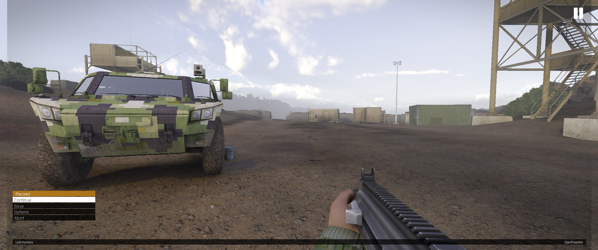
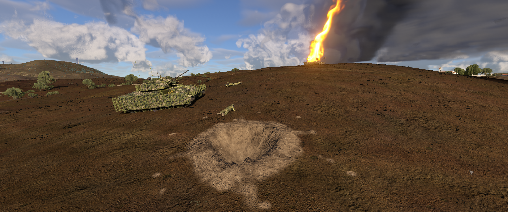
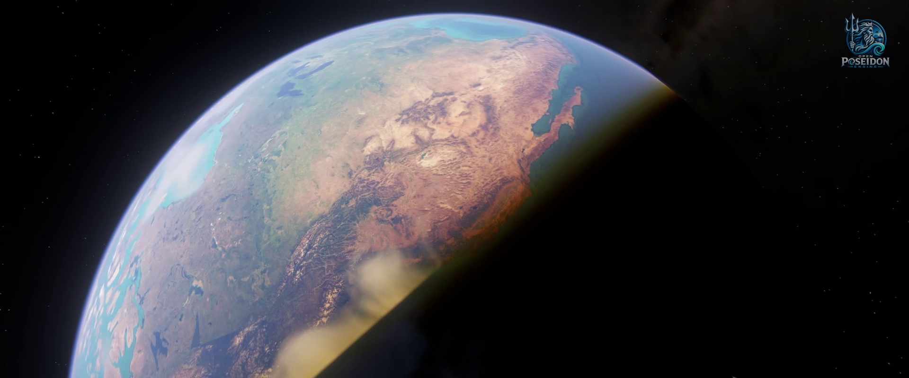
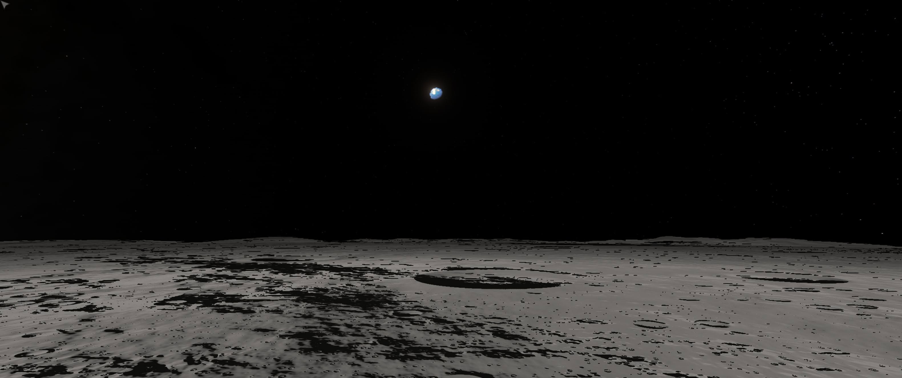
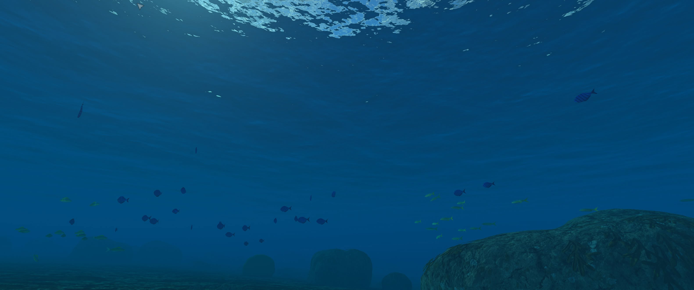
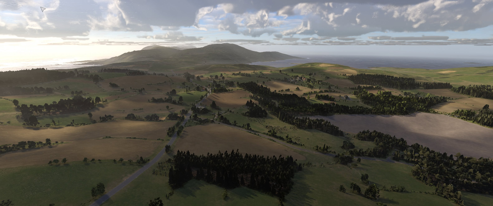

# Open Poseidon Engine

<p align="center">
  
</p>

[](https://github.com/sponsors/koosoli)
[](https://buymeacoffee.com/koosoli)

> [!TIP]
> **Don't want to compile? Ready-to-play Windows builds are waiting for you.**
> Sponsors get access to our private builds repository,
> [OpenPoseidon-Builds](https://github.com/OpenPoseidon/OpenPoseidon-Builds/releases),
> with tested, precompiled releases. Become a member through
> [GitHub Sponsors](https://github.com/sponsors/koosoli) for a small monthly
> contribution: you get the builds and directly help fund the project's
> development, testing and build distribution. Building from source stays free,
> and your rights under the software licences are the same either way.

**Open Poseidon Engine** is a modernization-focused fork of the classic Poseidon engine
behind *Arma: Cold War Assault* / *Operation Flashpoint: Cold War Crisis*.
Its goal is simple: make this landmark 2001 game feel as modern as possible
while preserving compatibility with the original assets, data formats, missions,
and gameplay.

> This is an independent community project and is not an official Bohemia
> Interactive product.

## Current preview

Development captures from Open Poseidon Engine, including original-game and locally
loaded Reforger content. They show features in progress rather than a promise
that every map, vehicle or material is fully supported.

| Arma 3 mission with its own pause menu | Volumetric fire, smoke and impact craters |
| --- | --- |
|  |  |
| **Whole-world rendering** | **The Moon with the Earth in its sky** |
|  |  |
| **Procedural fish schools under water** | **Rain puddles on a beach with driftwood** |
|  |  |
| **Arma Reforger terrain** | **Tidewater ocean** |
|  |  |
| **Wind-driven procedural grass** | **Layered volumetric fog** |
|  |  |
| **Snow depth and vehicle tracks** | **Destructible terrain and craters** |
|  |  |
| **GTAO and interior shading** | **Night lighting and shadows** |
|  |  |
| **Box3D physics test scene** | |
|  | |

## What Open Poseidon Engine adds

Open Poseidon Engine develops a modern [wgpu](https://wgpu.rs/)-based renderer alongside
the legacy OpenGL renderer, while retaining original OFP content and gameplay.
The current engine includes:

#### Worlds and content

> **No conversion, no copying.** Arma 1, 2, 3, DayZ and Reforger content loads
> straight from the original game's own installation folder. Point the engine at
> your installed game and play it in place: nothing is converted into a separate
> copy beforehand, and none of those games' files ship with Open Poseidon.

- **Arma 1, 2 and 3 missions (experimental):** missions and campaigns from your
  own Arma installations start from their native main menus, pause screens and
  mission dialogs, with their own weapons, sounds, voices, animals, scripted
  state machines and conversations. Arma 1 support is the furthest along: its
  missions bring their own weapons, sights, magazines, shot sounds, vehicles with
  their own sounds and gun points, the Arma 1 equipment slots and its stringtables,
  and Arma 1 units, vehicles and objects can be placed in the mission editor. Many missions play from start to finish; others
  still stop at missing script commands or content.
- **Whole-world rendering:** fly from the ground to orbit over the whole Earth,
  built from real elevation and imagery streamed at runtime. Mountains cast
  shadows across the ground, the sea is drawn out to the horizon, valleys fill
  with fog and snowlines follow the season. A real-time Moon has its own relief and
  craters, and the Earth hangs in its sky. A scripted ICBM can be flown across the
  globe with a follow camera.
- **Arma 1, 2, 3, Reforger and DayZ terrains:** locally installed worlds load
  with their own buildings, vegetation, roads, materials and far-distance trees.
  Reforger worlds stream natively. Imported terrain opens in the native OFP mission
  editor with OFP units.
- **Island Editor and OFP Fusion:** a terrain editor with no object limit, and an
  archipelago built from all five locally installed classic islands.

#### Rendering

- **Vulkan rendering through WGPU:** Vulkan support on Windows and Linux,
  alongside Direct3D 12 on Windows. The active API depends on the platform,
  GPU and driver.
- **GTAO:** screen-space ambient occlusion and bent-normal ambient shading,
  with live developer controls and diagnostic views.
- **Global illumination (GI):** a local irradiance probe grid combines indirect
  sky lighting with coloured sunlight bounced from nearby surfaces.
- **Lighting and shadows:** dynamic sun/local-light shadows, contact shadows,
  muzzle illumination, atmospheric light scattering and script-created lights
  (Arma 2/3 light commands).
- **Vehicle paint and reflections:** clear-coat paint that reflects the sky and
  the lit ground, with screen-space reflections; glass, chrome and instruments
  are told apart from paint.
- **Volumetric clouds and procedural sky:** overcast controls shared with Zeus,
  stars, the Milky Way and cloud shadows affecting terrain, objects, grass and water.
- **Layered volumetric fog:** adjustable lower/upper heights, density, patchiness,
  valley/mountain presets, live controls, reset and a legacy-fog option. Local
  light scattering supports night lights and the player's torch.
- **GPU-driven trees:** dense forests, including Arma 3 and DayZ vegetation, are
  culled and drawn on the GPU.
- **Upscaling:** AMD FSR 1 and an optional local NVIDIA DLSS integration.
  The proprietary NGX SDK/runtime is not bundled; distributable builds disable
  DLSS. Its availability depends on build configuration and compatible hardware.

#### Fire, smoke and destruction

- **Volumetric fire and smoke:** a new fire and smoke system. Explosions start with a
  fireball, wrecks burn with flames that lean in the wind, and black smoke columns
  rise, drift and linger long after the fire. Smoke has buoyancy and wind
  response, self-shadowing and scene shadows, and room/portal-aware containment
  against walls, floors and ceilings, with flow through doorways. Containment
  depends on the building geometry/topology available to the engine.
- **Volumetric impact craters:** explosions dig real craters into the terrain,
  with thrown-out earth around the rim.
- **Holes in walls:** bullets and explosions break physical holes into walls.
- **Destructible terrain and editor:** brush deformation, small cuts,
  horizontal caves/tunnels, sinkholes, straight and tank trenches, and excavation
  selection/rotation/deletion. This extends terrain holes; it is not a general
  voxel-world simulation.
- **Combat effects:** muzzle flashes that light the shooter and the surroundings,
  ground explosions, snow bullet tracks and helicopter ground downwash particles.

#### Water, weather and wildlife

- **Tidewater ocean:** FFT waves, shoreline wetness, reflections, foam, wakes,
  spray, underwater rendering and caustics; projectile/explosion and helicopter
  interactions. Boats are rigid bodies that float at a real draft on the drawn
  waves and leave ripples.
- **Procedurally generated wildlife and coastline:** schools of fish gather around
  you under water. The sea floor has real depth, rocks and corals, and beaches
  get rippled sand, stones and driftwood. Surf, gulls, terns and whales are heard
  around the coast.
- **Procedural grass:** travelling gust fronts, spatial wind variation,
  configurable coverage and player/vehicle/explosion/downwash interactions.
- **Weather and puddles:** rain collects in puddles with ripples and drains away
  again, with wet ground and clothing, surface snow and terrain contact depressions.
- **Snow depth and deformation:** compressed foot/vehicle tracks and projectile
  marks in depth-bearing ground snow, alongside roof and vegetation snow cover.
- **Mud:** MudRunner-style mud with ruts, rolling resistance and mud thrown from
  wheels and tank tracks.

#### Soldiers, AI and gameplay

- **NPC chat (experimental):** talk to your squad, nearby soldiers, civilians and
  HQ by typing or by voice. A language model of your choice answers in character,
  using a live picture of the situation and the mission briefing. Hosted
  providers and fully local models (Ollama or any OpenAI-compatible server) are
  supported. Replies are spoken in 3D at the speaker, or over the radio. Orders
  you give in plain words (follow, hold, move, cover, engage, get in and more)
  run through the game's own commands; model output is never run as script. API
  keys stay on your computer.
- **New infantry animations:** seamless reloading while walking, leaning around
  corners (Q/E), jumping with a soft landing, swimming, and diving and surfacing.
- **Improved AI:** gunfire hearing/reporting, immediate orders and near-miss
  suppression. Soldiers remember where danger came from and search there, turn
  on whoever is shooting at them, look out from cover, avoid cover where a
  squad mate was hit and run from live grenades. Optional gradual spotting and
  cover/flank/search behavior. Behavior switches are configuration-dependent;
  this is not a universal new navigation system or complete replacement AI.
- **Physical inventory (single player):** open with **Tab ↹** on foot (**O** in vehicle control seats) for vicinity cargo,
  drag/drop, equipped slots and weight/volume budgets; **K** opens inventory
  settings, including optional bearing callouts, a bearing readout and
  grenade-launcher ground-range estimates. Includes 17 original realistic
  equipment icons; addon pictures and labelled tiles remain fallbacks.
  Multiplayer keeps classic Gear; Dev Tools and Zeus are disabled in multiplayer.
- **Box3D physics and articulated ragdolls:** jointed character bodies, death and
  explosion reactions, and bullet reactivation of supported runtime corpses.
  Automatic ragdolls default to on, with a Physics developer-tab toggle.
- **Firing from vehicles (FFV):** personal-rifle fire from configured passenger
  seats, aiming arcs, reload and action-menu Ready/Stow controls. Stock Jeep
  coverage is validated; other seats, weapon families and multiplayer are limited.
- **Steam Audio (default audio backend):** Valve's Steam Audio places every
  3D sound around you with binaural (HRTF) spatialisation, so headphones tell
  you where a shot or an engine is. Sounds are muffled by terrain and buildings
  between you and the source, rooms and surroundings add their own reverb, and
  diving brings underwater sound. The sea has its own soundscape: surf wave by
  wave, gulls, terns, whales and boat engines. The classic OpenAL backend
  remains available.

#### Engine and tools

- **Satellite terrain textures (satmaps):** authored satellite layers and an
  automatic classic-world far-colour bake incorporating static roofs/vegetation.
  This is a ground colour representation, not a replacement for live object LODs.
- **Local content browser and editor:** terrain discovery for installed Arma
  1/2/3, DayZ and Reforger content, partial format conversion and selected vehicle
  bridges.
- **Streaming and developer tools:** geometry/residency work, GPU timings,
  debug views, test harnesses and Zeus freefly/unit placement.
- **Multithreading:** enkiTS worker jobs for selected terrain/cache, texture
  conversion and audio work, plus asynchronous streaming and pipeline builds.
  This does not imply that every simulation/rendering operation runs on its own thread.

These features are at different stages of acceptance. Dense/aerial fog can still
show visible patterns; strong torch shafts are not visually accepted. Ragdoll
tests cover 37 locally present stock models, with two Camel pilot post-hit
settlement failures and remaining posture/save/network/budget limits. Weather
materials and modern-game material/LOD conversion still need visual refinement.
There is no claim of universal addon-rig support or complete modern-game import.
Arma 1, 2 and 3 missions are experimental: some still stop at missing script
commands or content, and they need your own Arma installations. Whole-world
rendering streams public elevation and imagery data and needs an internet
connection. NPC chat needs a language-model provider or a local model server of
your choice.

## Project lineage

Open Poseidon Engine is a fork of [paavohuhtala/CWR-CE](https://github.com/paavohuhtala/CWR-CE),
which is itself a fork of [ofpisnotdead-com/CWR-CE](https://github.com/ofpisnotdead-com/CWR-CE).
That community project continues Bohemia Interactive's official source release of
the original Poseidon engine. This fork builds on the work of all of those
projects and the Operation Flashpoint / Arma community that has kept the game
alive for more than two decades.
### Step-by-step Guides

There are installation/build guides for [Linux](docs/build/linux.md) and
[Windows](docs/build/win.md).

### Development Builds

Precompiled Windows builds are available to sponsors in
[OpenPoseidon-Builds](https://github.com/OpenPoseidon/OpenPoseidon-Builds/releases);
become a member through [GitHub Sponsors](https://github.com/sponsors/koosoli) to get access.

## Support the project

Much of this work involves long-running renderer development, testing on legacy
assets, and AI-assisted code exploration. If you would like to support the work,
funds go toward API usage and direct development costs for Open Poseidon Engine.

Use the GitHub Sponsors or Buy Me a Coffee buttons above to support the project.

## Quick start

### Requirements

- [Clang](https://clang.llvm.org/)
- [CMake](https://cmake.org/)
- [Ninja](https://ninja-build.org/)
- [vcpkg](https://vcpkg.io/)

On Windows:
On Windows, run the following commands:

```
winget install Ccache.Ccache Kitware.CMake LLVM.LLVM Ninja-build.Ninja PolarGoose.ClangFormat
winget install Microsoft.VisualStudio.BuildTools --custom '"--add Microsoft.VisualStudio.Workload.VCTools;includeRecommended"'
```

Then follow the instructions for [setting up
vcpkg](https://learn.microsoft.com/en-us/vcpkg/get_started/get-started?pivots=shell-powershell)
to get the required software.

```powershell
winget install Kitware.CMake LLVM.LLVM Ninja-build.Ninja
```

Then install and configure vcpkg following the
[official guide](https://learn.microsoft.com/en-us/vcpkg/get_started/get-started?pivots=shell-powershell).

Windows also needs the Windows SDK's `mt.exe` on `PATH`. Configuring from a
plain shell without it fails at the compiler check with `CMAKE_MT-NOTFOUND`,
which reads like a broken toolchain rather than a missing tool. Either build
from a Developer PowerShell, or add the SDK's bin directory yourself:

```powershell
$env:PATH = "C:\Program Files (x86)\Windows Kits\10\bin\<sdk-version>\x64;" + $env:PATH
```
On macOS, use the matching `macos-arm64-clang-rwdi` or `macos-x64-clang-rwdi` preset.

### Testing

Copy game binaries from `dist/` into the [Steam](https://store.steampowered.com/app/65790/Arma_Cold_War_Assault_Remastered/)
or [GOG](https://www.gog.com/en/game/arma_cold_war_assault) game's Remastered folder,
or the [Steam demo folder](https://store.steampowered.com/app/4819000/Arma_Cold_War_Assault_Remastered_Demo/), and start.

An existing `build/` directory hides this, because the cache already recorded
`mt.exe` — so the failure only shows up on a fresh clone.

### Build

```powershell
cmake --preset win-x64-clang-rwdi
cmake --build build/win-x64-clang-rwdi --target PoseidonGame
```
- [Apps](apps/README.md) - executable targets
- [Engine](engine/README.md) - engine libraries and Rust Trident tooling
- [Master server tools](mserver/README.md) - Rust service and CLI crates
- [Tests](tests/README.md) - test source trees; CI currently compiles them only
- `cmake/` - presets, toolchains, vcpkg triplets, and overlay ports
- `docs/` - auxiliary documentation
- `docker/` - container support for service and runtime environments
- `packages/` - ignored local game data staging area
- `resources/` - application icon resources
- `thirdparty/` - vendored third-party headers and sources

For Linux, use the matching `linux-x64-clang-rwdi` preset.

### Run with the WGPU renderer

Copy both the executable and `wgpu_renderer.dll` from the build output to a local
game installation, then launch from that installation directory:

```powershell
.\ColdWarAssault.exe --render wgpu --window --dev
```

Both binaries must come from the same build. Game data is separate from this
repository; the free
[*Arma: Cold War Assault Remastered* Demo](https://store.steampowered.com/app/4819000/Arma_Cold_War_Assault_Remastered_Demo/)
is suitable for local testing.

## Repository layout

- [apps](apps/README.md) — executable targets
- [engine](engine/README.md) — engine libraries and rendering backends
- [mserver](mserver/README.md) — master-server tools
- [tests](tests/README.md) — test source trees
- `cmake/` — presets, toolchains, and vcpkg configuration
- `resources/` — application resources
- `thirdparty/` — vendored third-party sources and headers

## Source, brand, and game data

The source code in this repository is licensed under the
[GNU GPL v3.0 or later](LICENSE), with additional terms under Section 7.

`ARMA`, `Operation Flashpoint`, their logos, and related marks are not granted by
this repository and remain the property of their respective owners. Models,
textures, sounds, missions, voices, and other game data are separate from this
repository and are distributed under the
[Arma Public License Share Alike](https://www.bohemia.net/community/licenses/arma-public-license-share-alike).

See [CREDITS.md](CREDITS.md), [CONTRIBUTING.md](CONTRIBUTING.md), and
[THIRD_PARTY_NOTICES.md](THIRD_PARTY_NOTICES.md) for more information.
The compiled binaries need game data to run. You can obtain the **free demo game
data** or the paid full game on Steam or GOG:

- *Arma: Cold War Assault Remastered* demo on Steam: <https://store.steampowered.com/app/4819000>
- *Arma: Cold War Assault Remastered* full game on Steam: <https://store.steampowered.com/app/65790>
- *Arma: Cold War Assault Remastered* full game on GOG: <https://www.gog.com/en/game/arma_cold_war_assault>

The full game data ships with the retail game. Whatever you do with assets is
governed by the APL-SA linked above; whatever you do with this source is governed by
the GPL with additional terms per Section 7 in [`LICENSE`](LICENSE).


## Contributing

This is the community continuation of the official source release. Pull requests,
bug reports, ports, tooling improvements, documentation updates, and development
ideas are welcome here.

Please use issues for bugs and proposals, and open pull requests for source,
build, test, or documentation changes. See [`CONTRIBUTING.md`](CONTRIBUTING.md)
for contribution guidelines.
