# Open Poseidon Engine

<p align="center">
  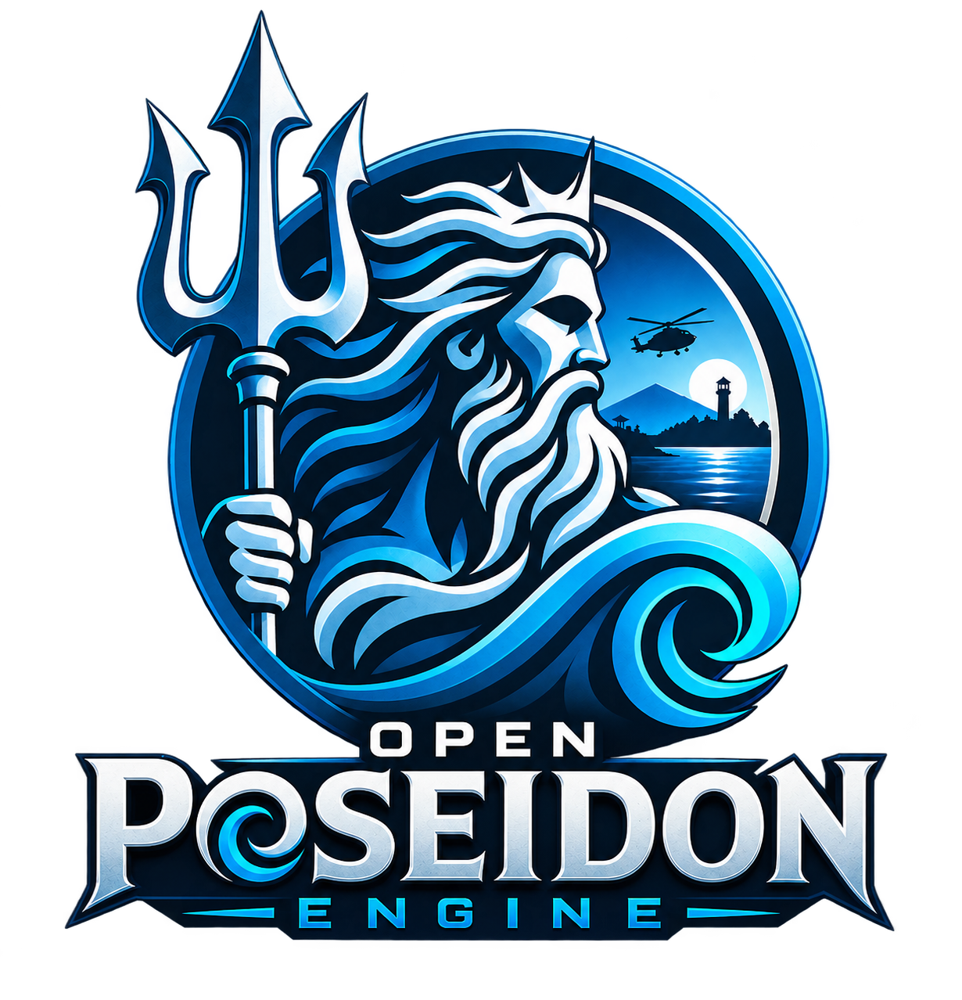
</p>

[](https://github.com/sponsors/koosoli)
[](https://buymeacoffee.com/koosoli)

**Open Poseidon Engine** is a modernization-focused fork of the classic Poseidon engine
behind *Arma: Cold War Assault* / *Operation Flashpoint: Cold War Crisis*.
Its goal is simple: make this landmark 2001 game feel as modern as possible
while preserving compatibility with the original assets, data formats, missions,
and gameplay.

> This is an independent community project and is not an official Bohemia
> Interactive product.

## Current preview

Development captures from Open Poseidon Engine, including original-game and locally
loaded Reforger content. They show features in progress rather than a promise
that every map, vehicle or material is fully supported.

| Tidewater ocean | Wind-driven procedural grass |
| --- | --- |
| 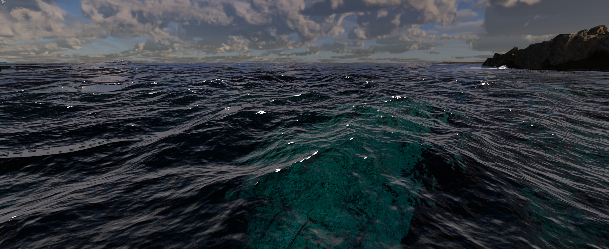 | 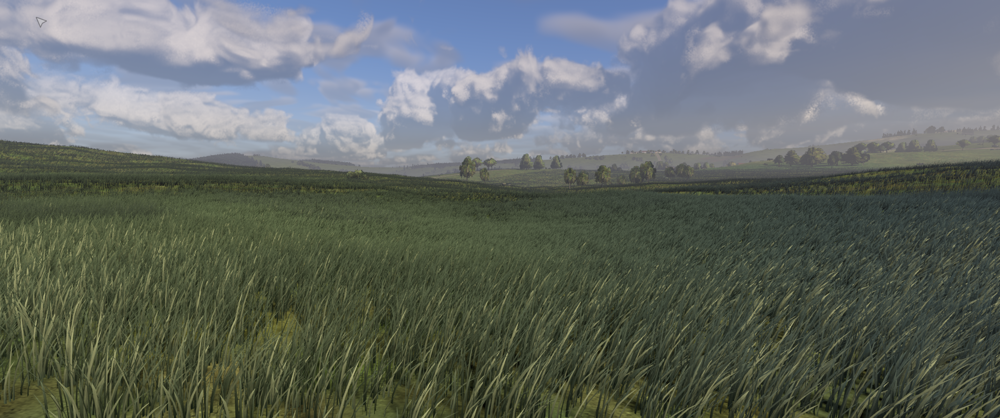 |
| **Layered volumetric fog** | **Rainwater and reflective puddles** |
| 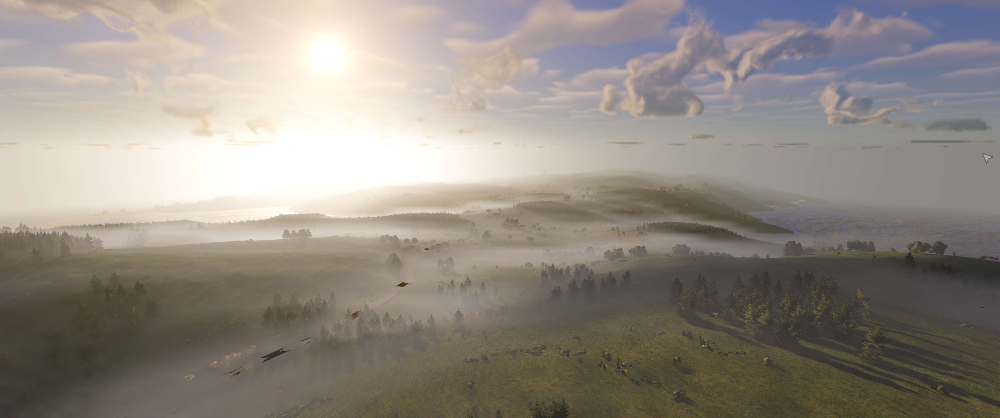 | 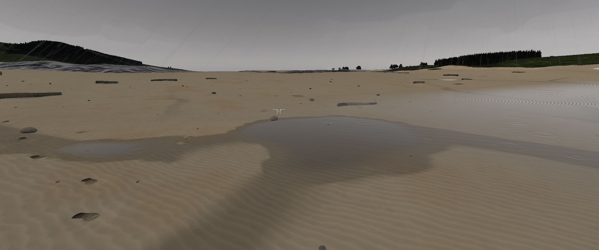 |
| **Snow depth and vehicle tracks** | **Destructible terrain and craters** |
| 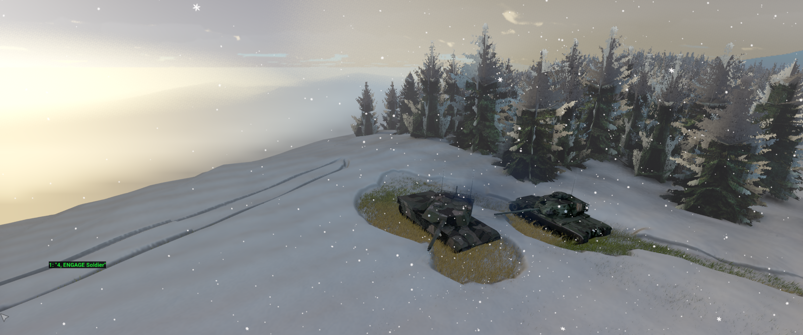 | 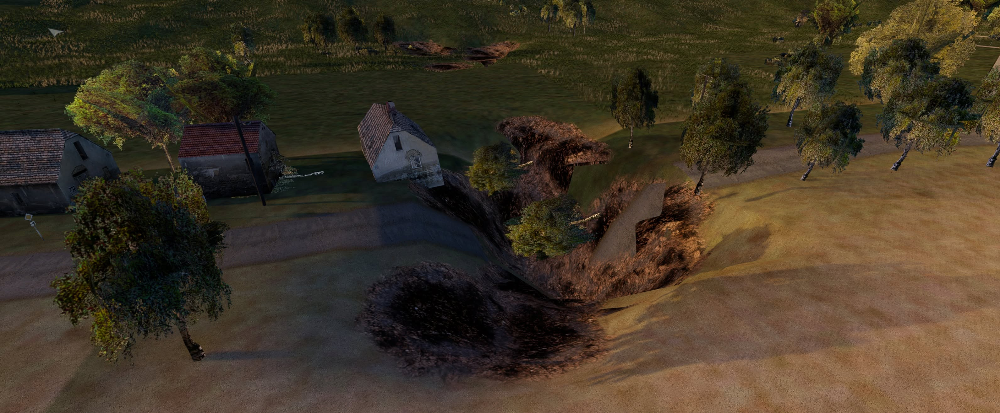 |
| **GTAO and interior shading** | **Night lighting and shadows** |
| 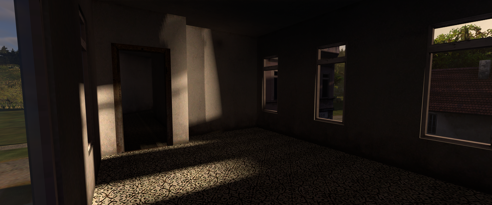 | 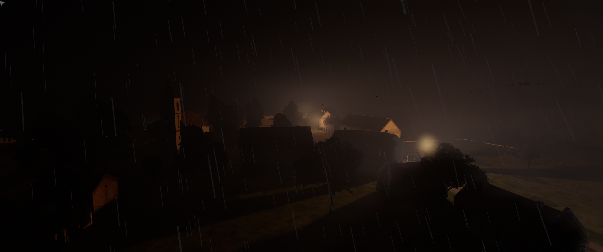 |
| **Box3D physics test scene** | **Local Reforger terrain compatibility** |
| 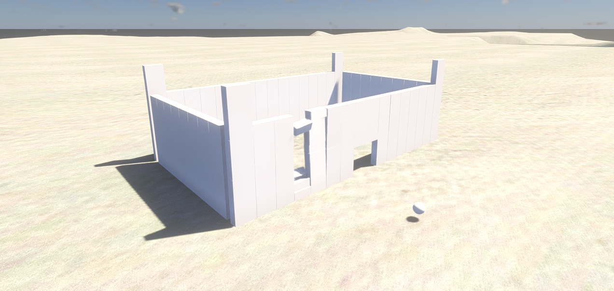 | 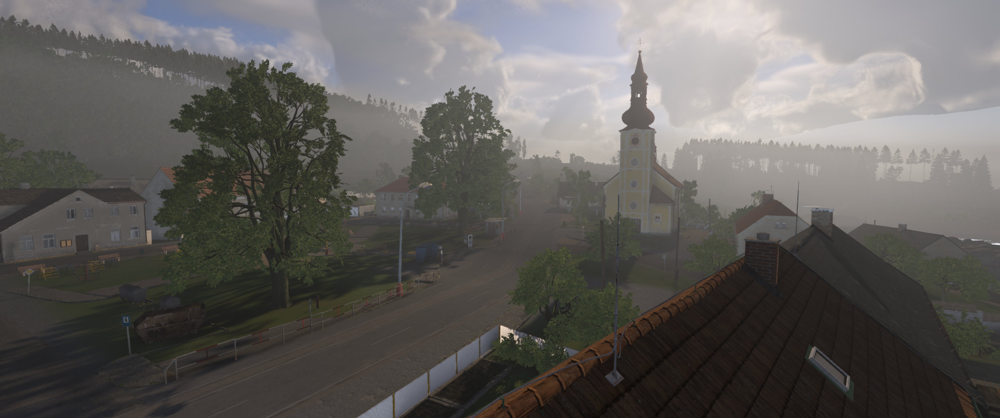 |

## What Open Poseidon Engine adds

Open Poseidon Engine develops a modern [wgpu](https://wgpu.rs/)-based renderer alongside
the legacy OpenGL renderer, while retaining original OFP content and gameplay.
The current engine includes:

- **Vulkan rendering through WGPU:** a modern graphics backend with Vulkan
  support on Windows and Linux, alongside Direct3D 12 on Windows. The active
  API depends on the platform, GPU and driver; the legacy OpenGL renderer remains
  available separately.
- **Physical inventory (single player):** open with **O** for vicinity cargo,
  drag/drop, equipped slots and weight/volume budgets; **K** opens inventory
  settings, including optional bearing callouts, a bearing readout and grenade-launcher
  ground-range estimates. Includes 17 original realistic equipment icons; addon pictures and
  labelled tiles remain fallbacks.
  Multiplayer keeps classic Gear; Dev Tools and Zeus are disabled in multiplayer.
- **Box3D physics and articulated ragdolls:** jointed character bodies, death and
  explosion reactions, and bullet reactivation of supported runtime corpses.
  Automatic ragdolls default to on, with an on/off control in the Physics dev tab.
- **Layered volumetric fog:** height-bounded layers, density, patchiness and
  valley/mountain presets; live Weather controls, a legacy mode and reset controls.
  Participating-light scattering includes night lights and the player's torch.
- **GTAO ambient occlusion:** screen-space contact shading and bent-normal ambient
  lighting, with developer controls and diagnostic views.
- **Improved lighting and shadows:** dynamic sunlight and local-light shadows,
  contact shadows, muzzle-light illumination and atmospheric light scattering.
- **Volumetric smoke:** buoyant, wind-driven plumes with room/portal-aware
  containment against walls, floors and ceilings, doorway flow, self-shadowing
  and shadows on the surrounding scene. Containment depends on the available
  building geometry and topology; arbitrary assets can still need fixes.
- **Volumetric clouds and a procedural sky:** overcast controls shared with Zeus,
  stars, and cloud shadows affecting terrain, objects, grass and water together.
- **Tidewater ocean rendering:** FFT waves, shoreline wetness, reflections, foam,
  wakes, spray, underwater rendering and caustics, plus projectile/explosion and
  helicopter interactions. Supported boats follow the drawn sea surface.
- **Procedural grass:** travelling gust fronts and spatial wind variation,
  configurable coverage, broader colour regions, and player, vehicle, explosion
  and rotor-wash interactions.
- **Rain, snow and wet surfaces:** accumulating/draining terrain water, rain
  ripples, wet ground and clothing shading, surface snow on terrain and objects,
  and snow/soft-ground contact imprints. Snowfall contributes default weather fog.
- **Snow depth and deformation:** depth-bearing ground snow with compressed
  foot/vehicle tracks and projectile marks, alongside roof and vegetation cover.
- **Deformable soft ground:** mud/sand/snow contact depressions and wheel ruts.
  Stock Jeep and Truck5t wet-mud rut/rolling-resistance paths are enabled;
  boot-sole normal/parallax relief remains an opt-in visual prototype.
- **Destructible terrain and editing:** explosion craters, brush deformation,
  small terrain cuts, horizontal cave/tunnel excavation,
  straight trenches and tank trenches, with excavation selection, rotation and
  deletion controls. These extend terrain holes rather than replacing the world
  with a general voxel simulation.
- **Combat and effects:** revised muzzle flashes with local shooter/surrounding
  illumination, snow projectile marks and helicopter ground downwash particles.
- **Firing from vehicles (FFV):** use a personal rifle from configured passenger
  seats, with aiming arcs, reload and action-menu Ready/Stow controls. The stock
  Jeep is the validated profile; this is not universal support for all cargo
  seats, weapon families or multiplayer.
- **Satellite terrain textures (satmaps):** supported authored satellite layers
  and an automatic classic-world far-colour bake including static roofs and
  vegetation. This improves distant ground representation without replacing
  live 3D buildings or object LODs.
- **Local content browser:** installed Arma 1/2/3, DayZ and Reforger terrain
  discovery and partial format compatibility. Select a terrain and use OFP units
  in the native mission editor without restarting; selected vehicle bridges are
  also available. Proprietary source content remains local.
- **Multithreading:** an enkiTS worker pool handles selected terrain/cache,
  texture conversion and audio jobs, alongside asynchronous streaming work.
  Parallelism is applied to specific workloads; the whole simulation is not
  claimed to run independently across every CPU core.
- **Upscaling:** AMD FSR 1 spatial upscaling/sharpening and an optional local
  NVIDIA DLSS integration. DLSS requires a compatible GPU and a separately
  supplied NGX SDK/runtime; distributable builds keep the proprietary path off.
- **Streaming and diagnostics:** geometry/residency work, GPU timing, graphics
  debug views, test harnesses and live developer controls. Zeus provides freefly
  movement and click-to-place units and vehicles.
- **Improved AI behavior:** gunfire hearing and reporting fixes, immediate order
  execution and near-miss suppression, plus optional gradual spotting and
  cover/flank/search behavior. Optional behavior is configuration-dependent;
  this is not a completed replacement AI or new universal navigation system.
- **Swimming:** swimmer movement and boat-route/boarding support.
  The third-party swimming animation addon is not bundled with the engine.

These features are at different stages of acceptance. Dense/aerial fog can still
show visible patterns; strong torch shafts are not visually accepted. Ragdoll
tests cover 37 locally present stock models, with two Camel pilot post-hit
settlement failures and remaining posture/save/network/budget limits. Weather
materials and modern-game material/LOD conversion still need visual refinement.
There is no claim of universal addon-rig support or complete modern-game import.

This remains the private development repository, with its history, agent
instructions and evidence. The separate release README is prepared under
[`docs/roadmap/publishing/public-files/README.md`](docs/roadmap/publishing/public-files/README.md).
See the [development/release workflow](docs/roadmap/publishing/DEVELOPMENT-AND-RELEASE-WORKFLOW.md)
for why the private preparation branch retains files excluded from a release.

## Project lineage

Open Poseidon Engine is a fork of [paavohuhtala/CWR-CE](https://github.com/paavohuhtala/CWR-CE),
which is itself a fork of [ofpisnotdead-com/CWR-CE](https://github.com/ofpisnotdead-com/CWR-CE).
That community project continues Bohemia Interactive's official source release of
the original Poseidon engine. This fork builds on the work of all of those
projects and the Operation Flashpoint / Arma community that has kept the game
alive for more than two decades.
### Step-by-step Guides

There are installation/build guides for [Linux](docs/build/linux.md) and
[Windows](docs/build/win.md).

### Development Builds

## Support the project

Much of this work involves long-running renderer development, testing on legacy
assets, and AI-assisted code exploration. If you would like to support the work,
funds go toward API usage and direct development costs for Open Poseidon Engine.

Use the GitHub Sponsors or Buy Me a Coffee buttons above to support the project.

## Quick start

### Requirements

- [Clang](https://clang.llvm.org/)
- [CMake](https://cmake.org/)
- [Ninja](https://ninja-build.org/)
- [vcpkg](https://vcpkg.io/)

On Windows:
On Windows, run the following commands:

```
winget install Ccache.Ccache Kitware.CMake LLVM.LLVM Ninja-build.Ninja PolarGoose.ClangFormat
winget install Microsoft.VisualStudio.BuildTools --custom '"--add Microsoft.VisualStudio.Workload.VCTools;includeRecommended"'
```

Then follow the instructions for [setting up
vcpkg](https://learn.microsoft.com/en-us/vcpkg/get_started/get-started?pivots=shell-powershell)
to get the required software.

```powershell
winget install Kitware.CMake LLVM.LLVM Ninja-build.Ninja
```

Then install and configure vcpkg following the
[official guide](https://learn.microsoft.com/en-us/vcpkg/get_started/get-started?pivots=shell-powershell).

Windows also needs the Windows SDK's `mt.exe` on `PATH`. Configuring from a
plain shell without it fails at the compiler check with `CMAKE_MT-NOTFOUND`,
which reads like a broken toolchain rather than a missing tool. Either build
from a Developer PowerShell, or add the SDK's bin directory yourself:

```powershell
$env:PATH = "C:\Program Files (x86)\Windows Kits\10\bin\<sdk-version>\x64;" + $env:PATH
```
On macOS, use the matching `macos-arm64-clang-rwdi` or `macos-x64-clang-rwdi` preset.

### Testing

Copy game binaries from `dist/` into the [Steam](https://store.steampowered.com/app/65790/Arma_Cold_War_Assault_Remastered/)
or [GOG](https://www.gog.com/en/game/arma_cold_war_assault) game's Remastered folder,
or the [Steam demo folder](https://store.steampowered.com/app/4819000/Arma_Cold_War_Assault_Remastered_Demo/), and start.

An existing `build/` directory hides this, because the cache already recorded
`mt.exe` — so the failure only shows up on a fresh clone.

### Build

```powershell
cmake --preset win-x64-clang-rwdi
cmake --build build/win-x64-clang-rwdi --target PoseidonGame
```
- [Apps](apps/README.md) - executable targets
- [Engine](engine/README.md) - engine libraries and Rust Trident tooling
- [Master server tools](mserver/README.md) - Rust service and CLI crates
- [Tests](tests/README.md) - test source trees; CI currently compiles them only
- `cmake/` - presets, toolchains, vcpkg triplets, and overlay ports
- `docs/` - auxiliary documentation
- `docker/` - container support for service and runtime environments
- `packages/` - ignored local game data staging area
- `resources/` - application icon resources
- `thirdparty/` - vendored third-party headers and sources

For Linux, use the matching `linux-x64-clang-rwdi` preset.

### Run with the WGPU renderer

Copy both the executable and `wgpu_renderer.dll` from the build output to a local
game installation, then launch from that installation directory:

```powershell
.\ColdWarAssault.exe --render wgpu --window --dev
```

Both binaries must come from the same build. Game data is separate from this
repository; the free
[*Arma: Cold War Assault Remastered* Demo](https://store.steampowered.com/app/4819000/Arma_Cold_War_Assault_Remastered_Demo/)
is suitable for local testing.

## Repository layout

- [apps](apps/README.md) — executable targets
- [engine](engine/README.md) — engine libraries and rendering backends
- [mserver](mserver/README.md) — master-server tools
- [tests](tests/README.md) — test source trees
- `cmake/` — presets, toolchains, and vcpkg configuration
- `resources/` — application resources
- `thirdparty/` — vendored third-party sources and headers

## Source, brand, and game data

The source code in this repository is licensed under the
[GNU GPL v3.0 or later](LICENSE), with additional terms under Section 7.

`ARMA`, `Operation Flashpoint`, their logos, and related marks are not granted by
this repository and remain the property of their respective owners. Models,
textures, sounds, missions, voices, and other game data are separate from this
repository and are distributed under the
[Arma Public License Share Alike](https://www.bohemia.net/community/licenses/arma-public-license-share-alike).

See [CREDITS.md](CREDITS.md), [CONTRIBUTING.md](CONTRIBUTING.md), and
[THIRD_PARTY_NOTICES.md](THIRD_PARTY_NOTICES.md) for more information.
The compiled binaries need game data to run. You can obtain the **free demo game
data** or the paid full game on Steam or GOG:

- *Arma: Cold War Assault Remastered* demo on Steam: <https://store.steampowered.com/app/4819000>
- *Arma: Cold War Assault Remastered* full game on Steam: <https://store.steampowered.com/app/65790>
- *Arma: Cold War Assault Remastered* full game on GOG: <https://www.gog.com/en/game/arma_cold_war_assault>

The full game data ships with the retail game. Whatever you do with assets is
governed by the APL-SA linked above; whatever you do with this source is governed by
the GPL with additional terms per Section 7 in [`LICENSE`](LICENSE).


## Contributing

This is the community continuation of the official source release. Pull requests,
bug reports, ports, tooling improvements, documentation updates, and development
ideas are welcome here.

Please use issues for bugs and proposals, and open pull requests for source,
build, test, or documentation changes. See [`CONTRIBUTING.md`](CONTRIBUTING.md)
for contribution guidelines.
